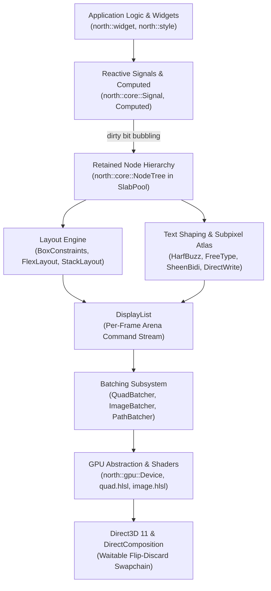

# North Toolkit

North Toolkit is a high-performance, GPU-accelerated, cross-platform UI toolkit built in modern C++20 under the `north::` namespace. Designed with a tier-1 focus on Windows (Direct3D 11 with DirectComposition and waitable swapchains), North provides a reactive, retain-mode UI pipeline engineered for deterministic low latency, predictable cache utilization, and analytic rendering fidelity.

---

## Architectural Highlights

- **Zero Exceptions & RTTI**: Compiles strictly with `/EHs-c- /D_HAS_EXCEPTIONS=0` and `/GR-` under MSVC (`-fno-exceptions -fno-rtti` on Clang), eliminating exception tables and runtime type overhead.
- **Predictable Memory Architecture**: Per-frame growable bump arena (`north::core::Arena`) for ephemeral allocations and display list commands, paired with a pointer-stable slab pool (`north::core::SlabPool<Node>`) using 64-bit generational handles.
- **Analytic GPU Shaders**: Bufferless quad rendering via `SV_VertexID` in HLSL evaluating exact signed distance fields (SDF) for rounded rects, inner borders, and Evan Wallace rational erf Gaussian box shadows. Textured quads feature bilinear sampling and subpixel SDF corner clipping.
- **Comprehensive Text Pipeline**: Industrial-grade typographic stack integrating HarfBuzz (shaping), FreeType (rasterization), SheenBidi (bidi reordering), libunibreak (line and grapheme breaking), and DirectWrite system font fallback. Rendered via a dynamic R8 skyline shelf atlas with 4-bin horizontal subpixel positioning.
- **Material 3 CAM16 HCT Perceptual Color Model**: Exact bisection gamut mapping ensuring mathematically guaranteed contrast across light and dark seed-generated tonal palettes.
- **Workstation-Grade Widget & Navigation Catalog**: Includes `SplitView`, virtualized `TreeView` and `DataTable`, multiline `TextArea` with undo/redo and system clipboard, `TabBar`/`TabsView`, `SegmentedButton`, `Accordion`, `Select`, `ComboBox`, and fuzzy-matched `CommandPalette` with global keyboard accelerators.
- **Declarative Builder Ergonomics**: Flat, composable widget builders with reactive push-dirty/pull-cached signals, modular widget data domains (`src/north/widget/data/`), and nine-point anchor positioning.

---

## Reactive Pipeline Architecture

The toolkit executes as a strict unidirectional pipeline, keeping layout resolution, paint recording, and GPU dispatch decoupled and cache-friendly:



---

## Quick Start

### Prerequisites

- **Operating System**: Windows 10 (version 1809+) or Windows 11
- **Compiler**: Visual Studio 2022 / 2026 (MSVC 19.38+) or Clang-cl 18+
- **Build System**: CMake 3.28+ and Ninja
- **Windows SDK**: Windows 10/11 SDK (10.0.22000.0 or newer with Direct3D 11, DirectComposition, and WIC support)

### Cloning the Repository

North Toolkit vendors third-party dependencies as Git submodules (`harfbuzz`, `freetype`, `sheenbidi`, `libunibreak`, `googletest`). Clone recursively:

```powershell
git clone --recursive https://github.com/north-toolkit/north.git
cd north
```

If already cloned without submodules, initialize them:

```powershell
git submodule update --init --recursive
```

### Building with CMake Presets

Configure and build using the provided CMake presets (`CMakePresets.json` v6):

```powershell
# Configure using MSVC Debug preset
cmake --preset debug-msvc

# Build all targets (libraries, tests, examples)
cmake --build --preset debug-msvc

# Build only the showcase example
cmake --build --preset debug-msvc --target hello_north
```

### Running the Test Suite

Execute the GoogleTest suite via CTest:

```powershell
ctest --preset debug-msvc --output-on-failure
```

---

## Minimal Example

The following example initializes a Direct3D 11 window, constructs a reactive counter signal, builds a styled button that mutates state upon click, and runs the application loop:

```cpp
#include "north/core/tree.hpp"
#include "north/core/signal.hpp"
#include "north/event/input_dispatcher.hpp"
#include "north/gpu/d3d11/d3d11_device.hpp"
#include "north/platform/win32/win32_app.hpp"
#include "north/platform/win32/win32_window.hpp"
#include "north/render/renderer.hpp"
#include "north/style/theme.hpp"
#include "north/widget/box.hpp"
#include "north/widget/button.hpp"
#include "north/widget/text.hpp"

#include <memory>
#include <string>

using namespace north;

int main() {
    platform::win32::Win32Window window;
    gpu::D3D11Device device;

    platform::win32::WindowDesc desc{
        .title = "North Minimal Example",
        .width = 640,
        .height = 480,
        .resizable = true
    };

    if (!window.create(desc, &device)) {
        return 1;
    }

    render::Renderer renderer(device);
    if (!renderer.init()) {
        return 1;
    }

    core::NodeTree tree;
    auto dispatcher = std::make_unique<event::InputDispatcher>(tree);
    dispatcher->set_window(&window);
    window.set_listener(dispatcher.get());

    // Reactive counter state
    core::Signal<int> counter(0);

    // Rebuild tree on signal state update
    auto build_ui = [&]() {
        if (tree.root().is_valid()) {
            tree.destroy_node(tree.root());
        }

        std::string label = "Clicked " + std::to_string(counter.get()) + " times";

        auto btn = widget::ButtonBuilder(tree)
                       .label(label)
                       .on_click([&]() { counter.set(counter.get() + 1); })
                       .build();

        auto root = widget::BoxBuilder(tree)
                        .flex(layout::FlexDirection::Column,
                              layout::MainAxisAlignment::Center,
                              layout::CrossAxisAlignment::Center)
                        .background(core::Color::from_rgba8(20, 22, 28, 255))
                        .padding(core::Edges::uniform(24.0f))
                        .child(btn)
                        .build();

        tree.set_root(root);
        dispatcher->reset();
    };

    counter.subscribe([](int, void* ctx) {
        auto* fn = static_cast<decltype(build_ui)*>(ctx);
        (*fn)();
    }, &build_ui);

    build_ui();

    auto& app = platform::win32::Win32App::instance();
    app.register_window(&window);

    app.set_idle_callback([&]() {
        if (!window.is_open()) return;
        core::Size sz = window.size();
        if (sz.width <= 0.0f || sz.height <= 0.0f) return;

        tree.layout(layout::BoxConstraints::tight(sz));
        renderer.render_frame(tree, sz, core::Color::from_rgba8(20, 22, 28, 255));
        device.present();
    });

    window.show(true);
    app.run();

    return 0;
}
```

---

## Documentation Index

Explore detailed subsystem specifications, mathematical derivations, and architecture documents in the [`docs/`](docs/) directory:

1. [**Architecture & Lifecycle**](docs/architecture.md): Unidirectional pipeline, Win32 platform integration, waitable swapchain frame pacing, and event routing.
2. [**Memory Architecture**](docs/memory.md): Chunked per-frame bump allocator (`Arena`), generational slab pools (`SlabPool<T>`), and zero-churn guarantees.
3. [**Reactive State & Hierarchy**](docs/reactive-and-tree.md): Small Buffer Optimization signals, computed derivations, bitmask dirty bubbling, and constraints layout.
4. [**GPU Rendering & Shaders**](docs/rendering-and-gpu.md): Direct3D 11 backend, `DisplayList`, instanced quad/image/path batchers, and analytic SDF/ERF HLSL shaders.
5. [**Text Pipeline & Typography**](docs/text-and-typography.md): HarfBuzz shaping, FreeType rasterization, SheenBidi, libunibreak, DirectWrite fallback, and subpixel `GlyphAtlas`.
6. [**Widgets & Material 3 Theming**](docs/widgets-and-theming.md): Material 3 CAM16 HCT color model, tonal design tokens, widget catalog, and `OverlayManager`.

---

## License

North Toolkit is open-source software licensed under the MIT License.
