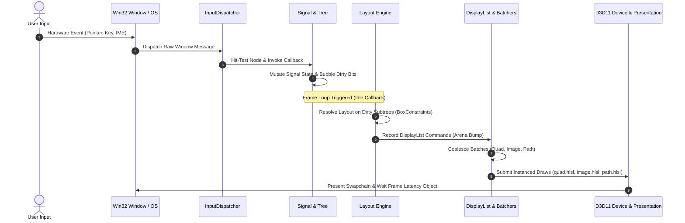
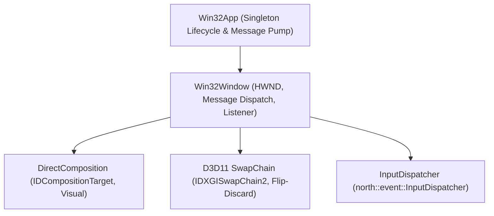

# Architecture & Lifecycle

North Toolkit implements a strict unidirectional reactive UI pipeline engineered in modern C++20. Designed with a tier-1 focus on Windows, the system pairs low-level Win32 platform integration (Per-Monitor V2 DPI awareness, DirectComposition visual targets, and waitable swapchains) with an exception-free, cache-coherent rendering pipeline.

---

## 1. Unidirectional Pipeline

The core execution model enforces unidirectional state flow. Application logic mutates reactive signals, which flag dirty bits on retained nodes. The engine then resolves layout for dirty subtrees, records render commands into a per-frame memory arena, batches consecutive primitives, and submits instanced draw calls to the Direct3D 11 device.



### Pipeline Stages

1. **Input Interception**: The platform message pump converts native `WM_*` messages into normalized event structures (`PointerEvent`, `KeyEvent`, `TextEvent`). The [`InputDispatcher`](../src/north/event/input_dispatcher.hpp) traverses the retained node tree from top-to-bottom using hit-test protocols.
2. **State & Reactive Dirty Propagation**: Mutating a [`Signal<T>`](../src/north/core/signal.hpp) executes registered observer callbacks. Observers mark associated nodes dirty. Dirty bits (`kLayout`, `kPaint`, `kTransform`, `kChildren`) bubble upward to the tree root, allowing subsequent passes to bypass clean branches.
3. **Layout Pass**: If the root node is marked with `NodeDirty::kLayout`, [`NodeTree::layout`](../src/north/core/tree.hpp) evaluates [`BoxConstraints`](../src/north/layout/constraints.hpp). Layout algorithms (Flex, Stack) size children and assign computed bounds, resetting the dirty layout flags.
4. **Display List Recording**: The paint pass traverses visible nodes in z-order, appending lightweight draw commands (`DrawQuadCmd`, `DrawImageCmd`, `DrawPathCmd`, `DrawGlyphCmd`) into a per-frame [`Arena`](../src/north/core/arena.hpp).
5. **Batching & GPU Submission**: Consecutive commands sharing compatible pipeline states and textures are merged into contiguous instance arrays by dedicated batchers ([`QuadBatcher`](../src/north/render/quad_batcher.hpp), [`ImageBatcher`](../src/north/render/image_batcher.hpp), [`PathBatcher`](../src/north/render/path_batcher.hpp)).
6. **Presentation Pacing**: Direct3D 11 swapchains present using `DXGI_SWAP_EFFECT_FLIP_DISCARD`. Waitable frame latency handles (`IDXGISwapChain2::GetFrameLatencyWaitableObject`) pace rendering to prevent CPU queue buildup and latency spikes.

---

## 2. Platform Integration (Win32)

The platform abstraction layer isolates operating system complexities into flat, lightweight classes within `north::platform::win32`:



### Win32App
- **Application Lifecycle**: Manages application registration, active windows, and the primary message loop.
- **Message Pump**: Uses `PeekMessage` with `PM_REMOVE` to drain all incoming operating system messages. When no OS messages remain, executes the registered idle callback for frame rendering.
- **DPI Context**: Initializes the thread with `DPI_AWARENESS_CONTEXT_PER_MONITOR_AWARE_V2` on startup, ensuring crisp vector rendering and accurate metric scaling across displays.

### Win32Window
- **DirectComposition Integration**: Rather than rendering directly into standard window client areas, `Win32Window` binds swapchains to `IDCompositionVisual` targets attached to an `IDCompositionTarget`. This enables transparent, tear-free compositing and hardware-accelerated presentation.
- **DPI Scaling**: Listens for `WM_DPICHANGED`. Updates local scale factor (`dpi_scale = dpi / 96.0f`) and resizes window geometry using the recommended rectangle provided in `lParam`.
- **IME Composition**: Captures `WM_IME_STARTCOMPOSITION`, `WM_IME_COMPOSITION`, and `WM_IME_ENDCOMPOSITION`, routing inline text input and composition strings directly to focused widgets.
- **Cursor Management**: Tracks mouse entry and exit using `TrackMouseEvent` (`TME_LEAVE`), resetting hover states when the pointer exits the window bounds.

---

## 3. Frame Latency & Presentation Pacing

Traditional desktop render loops often queue 2-3 frames of commands ahead in the GPU driver, resulting in noticeable input latency. North Toolkit solves this using Direct3D 11.2 waitable swapchains:

```cpp
// Setup waitable object during swapchain creation
DXGI_SWAP_CHAIN_DESC1 desc1{};
desc1.Flags = DXGI_SWAP_CHAIN_FLAG_FRAME_LATENCY_WAITABLE_OBJECT;
desc1.SwapEffect = DXGI_SWAP_EFFECT_FLIP_DISCARD;

// Set maximum frame latency to 1 for immediate responsiveness
ComPtr<IDXGISwapChain2> swapchain2;
swapchain.As(&swapchain2);
swapchain2->SetMaximumFrameLatency(1);
HANDLE frame_waitable = swapchain2->GetFrameLatencyWaitableObject();

// In the frame loop:
WaitForSingleObjectEx(frame_waitable, 1000, TRUE);
// Record commands and present...
swapchain->Present(1, 0);
```

This guarantees the CPU never begins recording frame $N+1$ until the GPU has finished displaying frame $N$, providing immediate sub-millisecond input responsiveness.

---

## 4. Unidirectional Data Flow Example

Here is how application state, reactive signals, and the platform shell integrate in a standard application loop:

```cpp
#include "north/core/tree.hpp"
#include "north/core/signal.hpp"
#include "north/event/input_dispatcher.hpp"
#include "north/gpu/d3d11/d3d11_device.hpp"
#include "north/platform/win32/win32_app.hpp"
#include "north/platform/win32/win32_window.hpp"
#include "north/render/renderer.hpp"
#include "north/widget/box.hpp"
#include "north/widget/button.hpp"

using namespace north;

int main() {
    platform::win32::Win32Window window;
    gpu::D3D11Device device;

    platform::win32::WindowDesc desc{.title = "North Lifecycle", .width = 800, .height = 600};
    if (!window.create(desc, &device)) return 1;

    render::Renderer renderer(device);
    if (!renderer.init()) return 1;

    core::NodeTree tree;
    event::InputDispatcher dispatcher(tree);
    dispatcher.set_window(&window);
    window.set_listener(&dispatcher);

    // State signal
    core::Signal<bool> toggled(false);

    auto rebuild_tree = [&]() {
        if (tree.root().is_valid()) tree.destroy_node(tree.root());

        auto btn = widget::ButtonBuilder(tree)
                       .label(toggled.get() ? "Active State" : "Inactive State")
                       .on_click([&]() { toggled.set(!toggled.get()); })
                       .build();

        auto root = widget::BoxBuilder(tree)
                        .flex(layout::FlexDirection::Column,
                              layout::MainAxisAlignment::Center,
                              layout::CrossAxisAlignment::Center)
                        .child(btn)
                        .build();

        tree.set_root(root);
        dispatcher.reset();
    };

    toggled.subscribe([](bool, void* ctx) {
        auto* fn = static_cast<decltype(rebuild_tree)*>(ctx);
        (*fn)();
    }, &rebuild_tree);

    rebuild_tree();

    auto& app = platform::win32::Win32App::instance();
    app.register_window(&window);

    app.set_idle_callback([&]() {
        if (!window.is_open()) return;
        core::Size sz = window.size();
        if (sz.width <= 0.0f || sz.height <= 0.0f) return;

        tree.layout(layout::BoxConstraints::tight(sz));
        renderer.render_frame(tree, sz, core::Color::from_rgba8(16, 17, 20, 255));
        device.present();
    });

    window.show(true);
    app.run();
    return 0;
}
```
