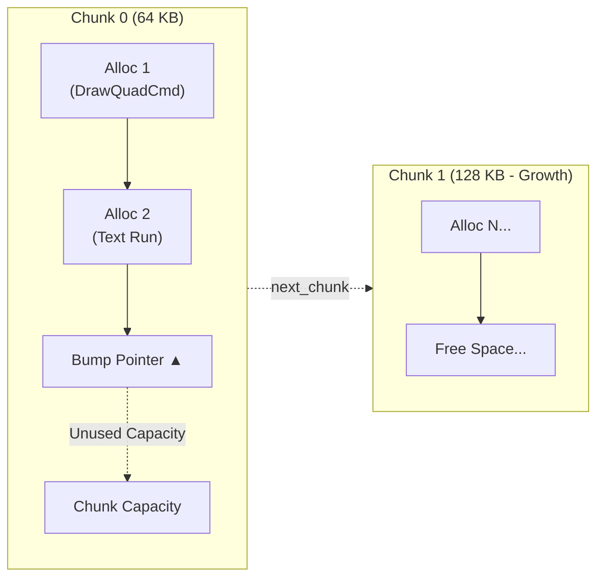
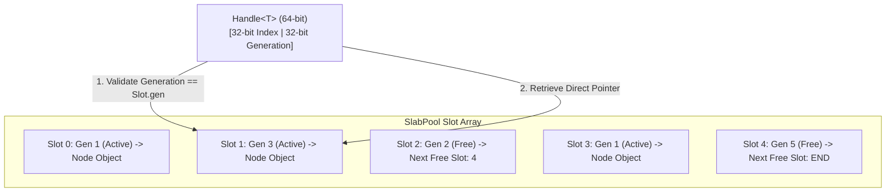

# Memory Architecture

High-performance GUI frameworks frequently suffer from heap fragmentation and memory churn caused by allocating ephemeral objects (strings, layout constraints, command buffers) and traversing scattered heap nodes. North Toolkit solves this through a dual-allocator architecture:

1. **Per-Frame Bump Arena (`north::core::Arena`)**: Linear bump allocation for transient frame data, retaining backing capacity across frames to eliminate heap churn.
2. **Generational Slab Pool (`north::core::SlabPool<T>`)**: Pointer-stable object pool with 64-bit generational handles for retained UI hierarchy nodes.

---

## 1. Per-Frame Bump Arena (`core::Arena`)

The [`Arena`](../src/north/core/arena.hpp) allocator operates as a linked list of contiguous memory chunks. Allocations simply advance an internal bump offset, guaranteeing $O(1)$ allocation time with zero per-object heap overhead.



### Characteristics & Invariants
- **Bump Allocation**: `alloc(size, align)` rounds the current pointer up to `align` and bumps the offset forward.
- **Chunked Growth**: If an allocation exceeds current chunk capacity, a new chunk is allocated (sized to at least double previous capacity or large enough to satisfy the allocation).
- **Per-Frame Reset**: At the conclusion of a frame, `arena.reset()` resets all bump offsets to zero without releasing chunk memory back to the operating system. Subsequent frames reuse warm heap pages, resulting in zero steady-state allocations.
- **Cache Locality**: Sequential allocations (e.g., contiguous draw calls in a display list) are laid out sequentially in physical memory, maximizing L1/L2 data cache hit rates.

### Arena Usage Example

```cpp
#include "north/core/arena.hpp"

struct DrawCommand {
    float x, y, w, h;
    uint32_t color;
};

void render_pass(north::core::Arena& arena) {
    // Allocate single object in arena
    auto* cmd = arena.create<DrawCommand>(10.0f, 20.0f, 100.0f, 50.0f, 0xFFFFFFFF);

    // Allocate contiguous array of primitives
    std::span<float> values = arena.alloc_array<float>(128);
    for (size_t i = 0; i < values.size(); ++i) {
        values[i] = static_cast<float>(i);
    }

    // At frame boundary: reclaim all memory at zero cost
    arena.reset();
}
```

---

## 2. Generational Slab Pool (`core::SlabPool<T>`)

Retained UI elements such as [`Node`](../src/north/core/node.hpp) require stable identification across tree mutations without risking use-after-free or dangling pointer bugs. North Toolkit utilizes [`SlabPool<T>`](../src/north/core/slab_pool.hpp) with 64-bit generational handles.



### Generational Handle Mechanics
A [`Handle<T>`](../src/north/core/slab_pool.hpp) consists of two 32-bit integer fields:
- `index`: Direct offset into the slot storage array.
- `generation`: Incremented each time an object at `index` is destroyed.

```cpp
template <typename T>
struct Handle {
    uint32_t index{0xFFFFFFFF};
    uint32_t generation{0};

    [[nodiscard]] bool is_valid() const noexcept {
        return index != 0xFFFFFFFF;
    }
};
```

When accessing a handle via `pool.get(handle)`:
1. If `handle.generation != slot.generation`, the target object has been destroyed or the slot repurposed. The lookup returns `nullptr` immediately.
2. Otherwise, returns a direct, type-safe pointer to the active `T` instance.

### Slab Pool Advantages
- **Pointer Stability**: Slots are allocated in fixed-size slab chunks (e.g., 256 objects per chunk). Growing the pool appends a new slab chunk without reallocating or moving existing slots, guaranteeing pointer stability for active elements.
- **Dangling Pointer Immunity**: Stale handles referencing deleted UI nodes fail generational validation without memory corruption.
- **Freelist Recycling**: Destroyed slots are pushed onto an internal singly-linked freelist, achieving $O(1)$ slot reuse.

---

## 3. Memory Alignment & GPU Structures

Vector operations, SIMD math, and Direct3D 11 constant buffers demand exact memory alignment:

- **16-Byte Alignment**: Vertex layouts ([`QuadInstance`](../src/north/gpu/types.hpp), [`ImageInstance`](../src/north/gpu/types.hpp), [`PathInstance`](../src/north/gpu/types.hpp)) and constant buffers are aligned to 16 bytes via `alignas(16)` to guarantee 128-bit vector register compatibility on CPU and GPU.
- **Cache-Line Alignment**: Memory chunk boundaries in [`Arena`](../src/north/core/arena.hpp) are aligned to 64-byte hardware cache lines (`alignof(std::max_align_t)`), preventing false sharing.

```cpp
// Direct3D 11 Instance Structure Alignment
struct alignas(16) QuadInstance {
    core::Rect rect;           // 16 bytes: x, y, width, height
    core::Color color;         // 16 bytes: r, g, b, a
    core::CornerRadii radii;   // 16 bytes: tl, tr, br, bl
    core::Rect clip_rect;      // 16 bytes: x, y, width, height
    core::Color border_color;  // 16 bytes: r, g, b, a
    core::Edges border_width;  // 16 bytes: top, right, bottom, left
    core::Color shadow_color;  // 16 bytes: r, g, b, a
    core::Point shadow_offset; // 8 bytes
    float shadow_blur;         // 4 bytes
    float shadow_spread;       // 4 bytes
};
```
