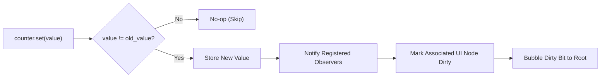
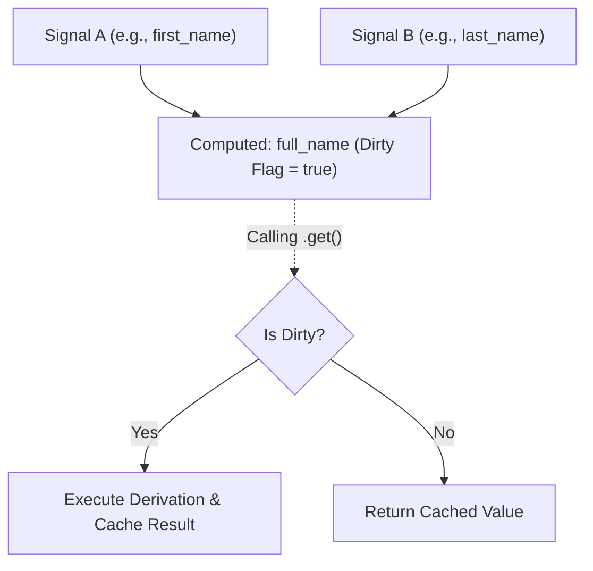
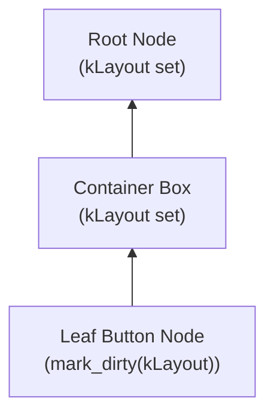

# Reactive State & Node Hierarchy

North Toolkit structures user interface state and presentation as a reactive, retained tree. Reactive signals propagate dirty notifications to retained node instances, allowing the layout engine and renderer to skip clean subtrees entirely.

---

## 1. Reactive Signals (`core::Signal<T>`)

[`Signal<T>`](../src/north/core/signal.hpp) provides observable value semantics. When state mutates, registered observers are notified immediately.



### Allocation-Free Observers (Small Buffer Optimization)
To eliminate memory allocations on observer registration:
- **Small Buffer Optimization (SBO)**: Up to 2 observers are stored inline within the `Signal<T>` struct. A heap vector is allocated only if 3 or more observers subscribe.
- **Raw Function Pointers**: Observers use function pointer callbacks (`void (*ObserverFn)(const T&, void*)`) paired with a `void*` context pointer, bypassing `std::function` dynamic type erasure allocations.

```cpp
#include "north/core/signal.hpp"

using namespace north::core;

void on_count_changed(const int& new_val, void* ctx) {
    // Context holds UI node or state handle
}

Signal<int> counter(0);

// Subscribes inline without heap allocation
counter.subscribe(on_count_changed, nullptr);
counter.set(42); // Invokes on_count_changed(42, nullptr)
```

---

## 2. Computed Derivations (`core::Computed<T>`)

[`Computed<T>`](../src/north/core/computed.hpp) encapsulates a derived value computed from one or more upstream signals. It uses a **push-dirty, pull-cached** evaluation strategy:

1. **Push-Dirty**: When upstream signals mutate, `Computed<T>` marks its cached value as dirty and notifies downstream observers without executing the derivation function.
2. **Pull-Cached**: Calling `computed.get()` evaluates the derivation lambda only if marked dirty; otherwise, it immediately returns the memoized value.



---

## 3. Retained Node Hierarchy (`core::NodeTree`)

The UI hierarchy is managed by [`NodeTree`](../src/north/core/tree.hpp). Each UI element is represented by a [`Node`](../src/north/core/node.hpp) stored inside a chunked [`SlabPool<Node>`](../src/north/core/slab_pool.hpp) and referenced via a 64-bit [`Handle<Node>`](../src/north/core/slab_pool.hpp).

### Node Protocols
Rather than virtual class hierarchies, `Node` behaviors are defined via lightweight C function pointers:

```cpp
using LayoutFn  = Size (*)(NodeTree& tree, Handle<Node> node, BoxConstraints constraints, void* user_data);
using PaintFn   = void (*)(NodeTree& tree, Handle<Node> node, DisplayList& dl, void* user_data);
using HitTestFn = bool (*)(const NodeTree& tree, Handle<Node> node, Point point, void* user_data);
```

### Bitmask Dirty Flags & Upward Bubbling
A node maintains bitmask dirty flags:

```cpp
enum class NodeDirty : uint8_t {
    kNone      = 0,
    kLayout    = 1 << 0,
    kPaint     = 1 << 1,
    kTransform = 1 << 2,
    kChildren  = 1 << 3,
    kAll       = 0xFF
};
```

When a node's state, text, or children mutate, `mark_dirty()` sets the corresponding flag and bubbles the dirty flag upward to all ancestors until reaching the root.



During the layout pass, branches with `NodeDirty::kNone` are skipped entirely, yielding sub-microsecond layout passes on large trees with localized changes.

---

## 4. Layout Subsystem

North Toolkit provides two primary layout engines: [`FlexLayout`](../src/north/layout/flex_layout.hpp) and [`StackLayout`](../src/north/layout/stack_layout.hpp).

### BoxConstraints
Layouts receive and pass [`BoxConstraints`](../src/north/layout/constraints.hpp):
- `min_width`, `max_width`, `min_height`, `max_height`
- `constrain(Size size)`: Clamps size within bounds.
- `loosen()`: Sets min width and height to 0.0f, retaining max bounds.
- `tighten(Size size)`: Forces both min and max to `size`.

### FlexLayout
A two-pass distribution engine supporting row and column axes:
- **Main Axis**: Distributes children along `FlexDirection::Row` or `FlexDirection::Column` using `MainAxisAlignment` (`Start`, `Center`, `End`, `SpaceBetween`, `SpaceAround`, `SpaceEvenly`).
- **Cross Axis**: Aligns children along `CrossAxisAlignment` (`Start`, `Center`, `End`, `Stretch`).
- **Flex Grow & Shrink**: Non-zero flex children divide remaining main axis space proportionally.
- **Gap Spacing**: Inserts uniform spacing between consecutive children.

### StackLayout
Overlays children in z-order:
- **Nine-Point Alignment**: Unpositioned children are aligned using `Alignment` (`TopLeft`, `Center`, `BottomRight`, etc.).
- **Edge Pinning**: Positioned children specify exact offsets via `PositionedData` (`left`, `top`, `right`, `bottom`, `width`, `height`).
