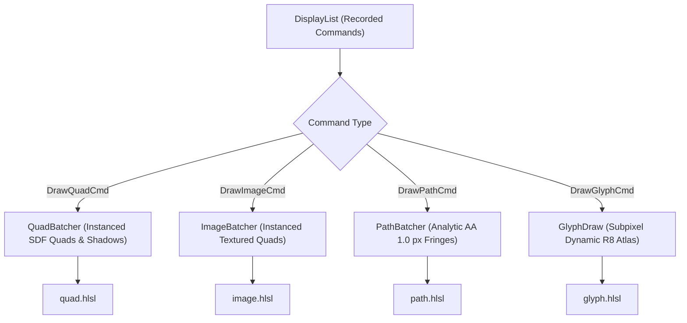

# GPU Rendering & Analytic Shaders

North Toolkit renders all user interface elements through hardware acceleration on Direct3D 11. Rather than relying on CPU rasterization or heavy multi-pass blur textures, the engine evaluates exact mathematical Signed Distance Fields (SDF) and rational error function ($\text{erf}$) box shadows directly within single-pass HLSL pixel shaders.

---

## 1. GPU Abstraction (`gpu::Device`)

The rendering engine decouples hardware APIs via the [`Device`](../src/north/gpu/device.hpp) interface, operating on lightweight 32-bit handles:

- `TextureId`: GPU 2D textures and shader resource views (e.g., dynamic glyph atlases, decoded images).
- `BufferId`: Dynamic vertex, index, instance, and constant buffers.
- `PipelineId`: Combined vertex and pixel shader state objects with input layout descriptors.

[`D3D11Device`](../src/north/gpu/d3d11/d3d11_device.hpp) provides the tier-1 Windows backend:
- **Flip-Discard Swapchains**: `DXGI_SWAP_EFFECT_FLIP_DISCARD` with `IDXGISwapChain2` frame latency pacing.
- **DirectComposition Integration**: Attaches swapchain visual targets directly to OS composition surfaces for tear-free alpha blending.
- **Headless Mode**: Supports offscreen render target textures for automated CI and regression test execution without creating OS windows.

---

## 2. Display List & Batching Subsystem

Rendering begins by traversing the retained node tree to record high-level drawing commands into [`DisplayList`](../src/north/render/display_list.hpp), backed by the per-frame bump [`Arena`](../src/north/core/arena.hpp).



### Instanced Batchers
- **[`QuadBatcher`](../src/north/render/quad_batcher.hpp)**: Merges consecutive rectangles, rounded panels, borders, and shadows into a dynamic instance buffer (`QuadInstance`), submitting them in a single `draw_instanced` call.
- **[`ImageBatcher`](../src/north/render/image_batcher.hpp)**: Batches textured quads sharing the same `TextureId`. Flushes whenever the bound texture handle changes.
- **[`PathBatcher`](../src/north/render/path_batcher.hpp)**: Takes triangulated fills and anti-aliased extruded edge strips from [`PathTessellator`](../src/north/render/path_tessellator.hpp), submitting them with analytic edge coverage.

---

## 3. Bufferless Quad Vertex Generation (`SV_VertexID`)

To eliminate the memory traffic of static vertex buffers for quads, North Toolkit uses bufferless vertex shaders. The GPU hardware generates quad vertices on-the-fly using `SV_VertexID`:

```hlsl
// quad.hlsl / image.hlsl vertex generation
struct VSOutput {
    float4 position : SV_Position;
    float2 local_pos : TEXCOORD0;
    nointerpolation float4 rect : RECT;
    nointerpolation float4 color : COLOR;
    nointerpolation float4 radii : RADII;
};

VSOutput main_vs(uint vertex_id : SV_VertexID, QuadInstance inst) {
    // 4 vertices of triangle strip: (0,0), (1,0), (0,1), (1,1)
    float2 uv = float2((vertex_id << 1) & 2, vertex_id & 2);
    float2 pos = inst.rect.xy + uv * inst.rect.zw;

    VSOutput output;
    output.position = mul(float4(pos, 0.0, 1.0), u_projection);
    output.local_pos = uv * inst.rect.zw;
    output.rect = inst.rect;
    output.color = inst.color;
    output.radii = inst.radii;
    return output;
}
```

---

## 4. Analytic SDF Rounded Rectangles

Rounded rectangles evaluate exact signed distance fields directly in pixel shaders. Anti-aliasing is achieved over a 1-pixel subpixel fringe without multisampling (MSAA):

```hlsl
float rounded_box_sdf(float2 p, float2 b, float4 r) {
    // Select per-corner radius based on quadrant
    float radius = (p.x > 0.0) ? ((p.y > 0.0) ? r.z : r.y)
                               : ((p.y > 0.0) ? r.w : r.x);
    float2 q = abs(p) - b + radius;
    return min(max(q.x, q.y), 0.0) + length(max(q, 0.0)) - radius;
}

float4 main_ps(VSOutput input) : SV_Target {
    float2 center = input.rect.zw * 0.5;
    float2 p = input.local_pos - center;
    float d = rounded_box_sdf(p, center, input.radii);

    // Analytic subpixel anti-aliasing
    float coverage = saturate(0.5 - d);
    return input.color * coverage;
}
```

---

## 5. Analytic Evan Wallace Rational ERF Box Shadows

Traditional Gaussian box shadows require expensive multi-pass texture blurs. North Toolkit computes exact Gaussian box shadows analytically in a single pass using Evan Wallace's rational approximation of the Gaussian error function ($\text{erf}(x)$):

$$\text{erf}(x) \approx \tanh\left(\frac{2}{\sqrt{\pi}}\left(x + \frac{11}{128} x^3\right)\right)$$

```hlsl
// 1D Gaussian box blur integral
float gaussian_box_integral(float x, float r, float sigma) {
    float inv_sqrt2_sigma = 1.0 / (1.41421356 * sigma);
    return 0.5 * (erf_approx((x + r) * inv_sqrt2_sigma) - erf_approx((x - r) * inv_sqrt2_sigma));
}

// 2D Gaussian shadow evaluation
float box_shadow_intensity(float2 p, float2 half_size, float sigma) {
    float x_integral = gaussian_box_integral(p.x, half_size.x, sigma);
    float y_integral = gaussian_box_integral(p.y, half_size.y, sigma);
    return saturate(x_integral * y_integral);
}
```

This delivers pixel-perfect, mathematically accurate drop shadows at zero texture memory overhead and deterministic shader runtime.
