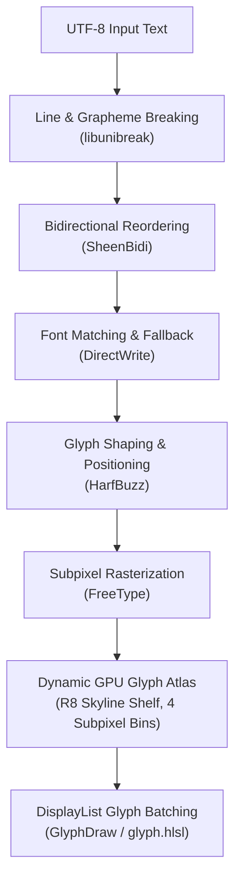
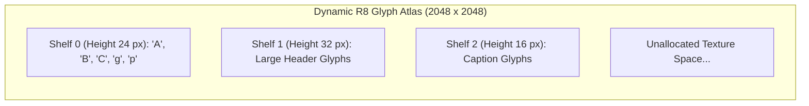

# Text Pipeline & Typography

North Toolkit features an industrial-grade text shaping and rasterization engine. Built to handle complex multilingual scripts, bidirectional text, and fractional typography, the pipeline integrates HarfBuzz, FreeType, SheenBidi, libunibreak, and DirectWrite system fallback into a unified cache-backed typography subsystem.

---

## 1. Multi-Engine Architecture

Text layout executes as a multi-stage pipeline converting UTF-8 strings into shaped glyph runs and packed GPU texture quads:



### Subsystem Roles
- **[`libunibreak`](../third_party/libunibreak/)**: Determines line-breaking opportunities according to Unicode Standard Annex #14 and grapheme cluster boundaries according to UAX #29.
- **[`SheenBidi`](../third_party/sheenbidi/)**: Implements the Unicode Bidirectional Algorithm (UAX #9) for mixed left-to-right (LTR) and right-to-left (RTL) scripts (e.g., Arabic, Hebrew).
- **DirectWrite Fallback**: When an active font face lacks glyph coverage for a Unicode codepoint, North queries DirectWrite system font collections to locate matching fallback fonts, avoiding "missing glyph" replacement boxes ($\Box$).
- **[`HarfBuzz`](../third_party/harfbuzz/)**: Performs OpenType complex script shaping, ligature substitution, kerning pairs, and mark attachment.
- **[`FreeType`](../third_party/freetype/)**: Loads vector glyph outlines and renders high-precision 8-bit anti-aliased alpha bitmaps with hinting.

---

## 2. Dynamic GPU Glyph Atlas (`GlyphAtlas`)

Rendered glyphs are cached on the GPU in a dynamic `R8_UNORM` texture atlas managed by a skyline shelf bin-packing algorithm.



### 4-Bin Subpixel Positioning
Rasterizing a glyph strictly at integer pixel coordinates causes noticeable jitter and irregular spacing during fractional scrolling or fine layout adjustments. North Toolkit solves this using **horizontal subpixel binning**:

- Each glyph key combines `(font_id, glyph_index, font_size, subpixel_bin)`.
- The fractional horizontal offset $x - \lfloor x \rfloor$ is mapped to one of 4 discrete subpixel bins:
  $$\text{bin} = \lfloor 4.0 \times (x - \lfloor x \rfloor) + 0.5 \rfloor \pmod 4 \in \{0.0\text{ px}, 0.25\text{ px}, 0.5\text{ px}, 0.75\text{ px}\}$$
- FreeType renders glyph bitmaps with the corresponding fractional subpixel shift, guaranteeing crisp, optically balanced typography without blurriness or color fringing.

### Cache Deduplication & Updates
- If a requested glyph is already resident in the atlas, its cached UV coordinates are returned in $O(1)$ time via a hash map lookup.
- If missing, FreeType rasterizes the bitmap, the skyline shelf allocator allocates atlas space, and [`Device::update_texture_region`](../src/north/gpu/device.hpp) streams only the dirty rectangle to the GPU.

---

## 3. Paragraph & Text Layout API

The high-level [`Paragraph`](../src/north/text/paragraph.hpp) and [`TextLayout`](../src/north/text/text_layout.hpp) structs coordinate shaping, word wrapping, and text measurement:

```cpp
#include "north/text/paragraph.hpp"
#include "north/text/font_cache.hpp"

using namespace north;

void layout_and_draw_text(text::FontCache& font_cache, render::DisplayList& dl) {
    text::TextStyle style{
        .font_family = "Segoe UI",
        .font_size = 16.0f,
        .line_height = 24.0f,
        .color = core::Color::from_rgba8(255, 255, 255, 255)
    };

    text::Paragraph paragraph(font_cache);
    paragraph.set_text("North Toolkit delivers high-performance native typography.", style);
    paragraph.set_max_width(400.0f); // Triggers automatic word wrapping

    paragraph.layout();

    core::Size measured_size = paragraph.size();
    paragraph.paint(dl, core::Point{20.0f, 20.0f});
}
```
