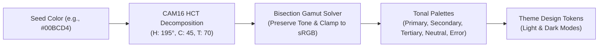
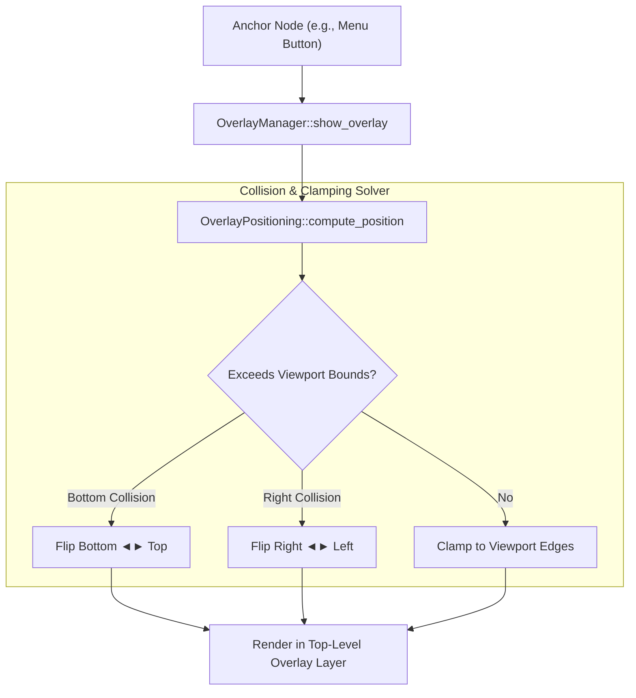

# Widgets & Material 3 Theming

North Toolkit provides a declarative, zero-cost widget layer styled using Material 3 CAM16 HCT perceptual color science. Widgets are built through fluent builder APIs that configure retained nodes in the node tree without intermediate allocations.

---

## 1. Material 3 CAM16 HCT Perceptual Color Model

Traditional RGB and HSL color models do not align with human visual perception: two colors with identical "lightness" in HSL can have drastically different perceived brightness. North Toolkit implements the **Material 3 CAM16 HCT** (Hue, Chroma, Tone) perceptual color space:

- **Hue ($H \in [0^\circ, 360^\circ)$)**: Perceptual color angle.
- **Chroma ($C \ge 0$)**: Color colorfulness / saturation.
- **Tone ($T \in [0, 100]$)**: Perceptual luminance matching human lightness perception ($L^*$).



### Contrast Guarantees
Because Tone ($T$) maps directly to human perceptual luminance, contrast ratios are mathematically guaranteed by Tone differences regardless of Hue:
- **$\Delta T \ge 40$**: Satisfies WCAG 2.2 AA contrast (4.5:1) for normal text.
- **$\Delta T \ge 30$**: Satisfies WCAG 2.2 AA contrast (3.0:1) for large text and UI components.

### Theme Token Generation
Themes are generated dynamically from an arbitrary seed color:

```cpp
#include "north/style/theme.hpp"

using namespace north::style;

// Generate dark theme palette from a brand seed color
north::core::Color seed = north::core::Color::from_rgba8(0, 188, 212, 255);
Theme dark_theme = Theme::make_dark(seed);

// Contrast guaranteed tokens:
// dark_theme.surface (Tone 10) vs dark_theme.on_surface (Tone 90) -> Delta T = 80 (Contrast > 10:1)
```

---

## 2. Declarative Widget Catalog & Modular Data Architecture

Widget state structures are partitioned into six cohesive headers under [`src/north/widget/data/`](../src/north/widget/data/) and aggregated via [`widget_data.hpp`](../src/north/widget/widget_data.hpp):
- [`core_data.hpp`](../src/north/widget/data/core_data.hpp): `WidgetKind`, `BoxData`, `TextData`, `IconData`, `ImageData`.
- [`form_data.hpp`](../src/north/widget/data/form_data.hpp): `ButtonData`, `TextInputData`, `TextAreaData`, `CheckboxData`, `SwitchData`, `SliderData`, `RadioButtonData`.
- [`scroll_data.hpp`](../src/north/widget/data/scroll_data.hpp): `ScrollAreaData`, `VirtualListData`, `ScrollbarStyle`.
- [`nav_data.hpp`](../src/north/widget/data/nav_data.hpp): `TabBarData`, `TabsViewData`, `SegmentedButtonData`, `AccordionData`.
- [`data_views.hpp`](../src/north/widget/data/data_views.hpp): `SplitViewData`, `TreeViewData`, `DataTableData`.
- [`picker_data.hpp`](../src/north/widget/data/picker_data.hpp): `CommandPaletteData`, `SelectData`, `ComboBoxData`.

All widgets use builder structs adhering to fluent value semantics:

| Widget | Builder Struct | Key Capabilities |
| :--- | :--- | :--- |
| **Box** | `BoxBuilder` | Flexible container with flex/stack layout, padding, background, borders, and rounded corners. |
| **Button** | `ButtonBuilder` | Interactive button supporting primary, secondary, text variants, hover states, and click callbacks. |
| **Checkbox** | `CheckboxBuilder` | Toggleable checkbox with reactive checked signal binding and checkmark path rendering. |
| **RadioButton** | `RadioButtonBuilder` | Radio option group selection with reactive value binding. |
| **Switch** | `SwitchBuilder` | Toggle switch with smooth sliding thumb and state transitions. |
| **Slider** | `SliderBuilder` | Continuous/discrete slider bar supporting min/max range mapping and drag gestures. |
| **Text** | `TextBuilder` | Static/reactive typography with font family, size, weight, and color styling. |
| **TextInput** | `TextInputBuilder` | Single-line editable text input supporting caret navigation, selection, and IME composition. |
| **TextArea** | `TextAreaBuilder` | Multiline text editor with line-number gutter, 2D cursor navigation, selection, and undo/redo. |
| **ScrollArea** | `ScrollAreaBuilder` | Scrollable viewport with spring-physics scrolling and dynamic scrollbars. |
| **VirtualList** | `VirtualListBuilder` | High-performance virtualized list rendering only visible items in large datasets. |
| **Icon** | `IconBuilder` | Declarative SVG vector icon renderer with theme tinting and sizing. |
| **Image** | `ImageBuilder` | WIC-decoded image view with `Fit`, `Cover`, `Fill`, `None`, and `ScaleDown` scaling and SDF rounded corners. |
| **TabBar / TabsView** | `TabBarBuilder`, `TabsViewBuilder` | Animated indicator tabs with icons, badges, close buttons, drag-reordering, and `KeepAlive`/`Lazy` views. |
| **SegmentedButton** | `SegmentedButtonBuilder` | Single- or multi-select pill toggle group with animated selection indicator. |
| **Accordion** | `AccordionBuilder` | Collapsible disclosure panels with rotating chevrons and height tweening. |
| **SplitView** | `SplitViewBuilder` | Resizable horizontal/vertical two-pane container with `Ratio`, `FixedFirst`, and `FixedSecond` modes. |
| **TreeView** | `TreeViewBuilder` | Virtualized hierarchical tree with indent guides, expandable nodes, SVG icons, and keyboard navigation. |
| **DataTable** | `DataTableBuilder` | Sticky-header multi-column table with interactive column resizing, tri-state sorting, and row virtualization. |
| **CommandPalette** | `CommandPaletteBuilder` | Modal quick-open palette with prefix modes (`>`, `@`, `#`), fuzzy filtering, and match highlighting. |
| **Select** | `SelectBuilder` | Overlay-anchored dropdown selector with keyboard and mouse navigation. |
| **ComboBox** | `ComboBoxBuilder` | Editable text field with real-time fuzzy-filtered dropdown popup. |
| **Dialog / Menu / Popover / Tooltip** | `DialogBuilder`, `MenuBuilder`, `PopoverBuilder`, `TooltipBuilder` | Modal and non-modal overlays with automatic `on_dismiss` node and callback cleanup. |

---

## 3. Overlay Subsystem (`OverlayManager`)

Overlays (dialogs, dropdown menus, context menus, tooltips, popovers) require rendering outside normal parent hierarchy bounds and layout clipping. North Toolkit provides [`OverlayManager`](../src/north/overlay/overlay_manager.hpp):



### Viewport Collision Flipping
When positioning an overlay against an anchor element:
- Default placement (e.g., `Placement::BottomCenter`) is evaluated.
- If the overlay extends past the bottom viewport edge, the positioning engine automatically flips it to `Placement::TopCenter`.
- If the overlay extends past the right viewport edge, it automatically flips to `Placement::LeftCenter`.
- Finally, coordinates are clamped within the active window boundaries, preventing offscreen clipping.

### Modal Event Interception & Deterministic Cleanup
Modal overlays (such as `Dialog`, `Menu`, `CommandPalette`, `Select`, and `ComboBox`) absorb outside pointer events:
- Clicking outside the overlay bounds or pressing the Escape key triggers `OverlayManager::dismiss_top_modal()`.
- `OverlayManager::hide_overlay` removes the active entry prior to invoking `OverlayConfig::on_dismiss`, preventing re-entrancy hazards.
- Ephemeral overlay nodes and action callback wrappers are bound to `on_dismiss` contexts so nodes and heap state are deterministically freed regardless of how the overlay is closed.

---

## 4. Widget Composition Example

```cpp
#include "north/core/tree.hpp"
#include "north/style/theme.hpp"
#include "north/widget/box.hpp"
#include "north/widget/button.hpp"
#include "north/widget/checkbox.hpp"
#include "north/widget/image.hpp"
#include "north/widget/text.hpp"

using namespace north;

core::Handle<core::Node> build_settings_panel(core::NodeTree& tree,
                                              gpu::Device& device,
                                              const style::Theme& theme) {
    auto title = widget::TextBuilder(tree)
                     .text("Toolkit Settings")
                     .font_size(20.0f)
                     .color(theme.on_surface)
                     .build();

    auto enable_sync = widget::CheckboxBuilder(tree)
                           .label("Enable Cloud Synchronization")
                           .checked(true)
                           .build();

    auto avatar = widget::ImageBuilder(tree)
                      .load_file(device, "assets/images/download.jpg")
                      .content_scale(image::ContentScale::Fit)
                      .corner_radii(core::CornerRadii::uniform(12.0f))
                      .size(core::Size{120.0f, 120.0f})
                      .build();

    auto save_btn = widget::ButtonBuilder(tree)
                        .label("Save Configuration")
                        .variant(widget::ButtonVariant::Filled)
                        .build();

    return widget::BoxBuilder(tree)
        .flex(layout::FlexDirection::Column,
              layout::MainAxisAlignment::Start,
              layout::CrossAxisAlignment::Stretch)
        .background(theme.surface_container)
        .corner_radii(core::CornerRadii::uniform(16.0f))
        .padding(core::Edges::uniform(20.0f))
        .gap(16.0f)
        .child(title)
        .child(avatar)
        .child(enable_sync)
        .child(save_btn)
        .build();
}
```
